# UniThrive — Tu compañero universitario inteligente 🎓🚀

UniThrive es una aplicación **Flutter offline-first** para estudiantes universitarios que convierte el caos académico en un plan claro: horario, tareas, proyectos, recordatorios, foco y progreso personal en un solo lugar.

<p align="center">
  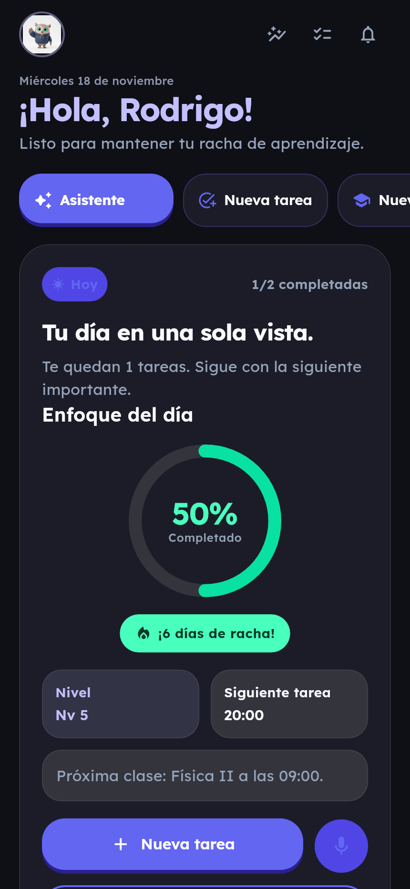
  <br />
  <em>Inicio: tu día, tu racha y tus siguientes pasos en una sola vista.</em>
</p>


## ✨ Lo que hace diferente a UniThrive

- **Sin backend ni cuenta en la nube.** Todo se guarda localmente en el dispositivo.
- **Dictado por voz sin conexión.** Parsea tareas y horarios en español, con vista previa editable antes de guardar.
- **Planificación visual.** Calendario semanal/mensual, carga académica, proyectos y subtareas con progreso real.
- **Foco con Pomodoro.** Sesiones con checklist de activación, tiempo acumulado e historial.
- **Gamificación con mascota.** XP, niveles, rachas y logros por rareza.
- **Multiperfil.** Perfiles de estudio independientes con snapshots locales y exportación/importación total.

---

## 📸 Recorrido por la aplicación

### 🏠 Inicio y visión del día

| Inicio | Panel supervisual |
|:---:|:---:|
|  | 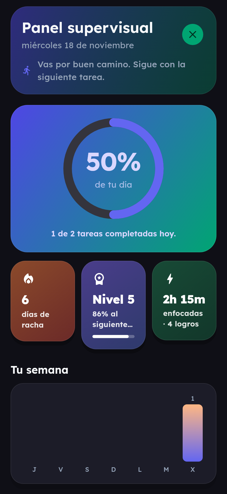 |
| **Todo el día en una tarjeta**: progreso circular, racha, nivel, siguiente tarea, próxima clase y accesos rápidos al asistente, nueva tarea, voz, búsqueda, alarma y foco. | **Analítica instantánea**: porcentaje completado, racha, nivel, tiempo enfocado, logros y mini gráfica de los últimos siete días. |

### 📅 Calendario y proyectos

| Horario semanal | Proyectos |
|:---:|:---:|
| 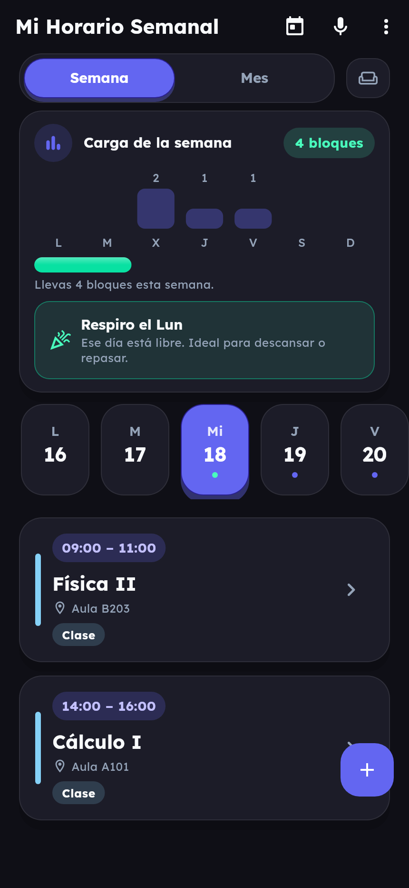 | 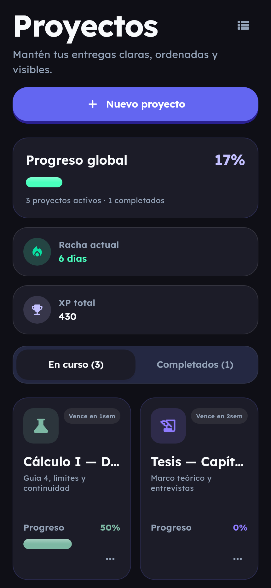 |
| **Vista Semana / Mes**, carga de bloques por día, timeline de clases con aula y conflicto, exportación/importación `.ics` y dictado de horarios. | **Progreso global**, proyectos activos/completados, racha, XP y tarjetas con avance, etiqueta y vencimiento. Vista de cuadrícula o lista. |

### ✅ Tareas, detalle y planificación

| Centro de tareas | Detalle de tarea |
|:---:|:---:|
| 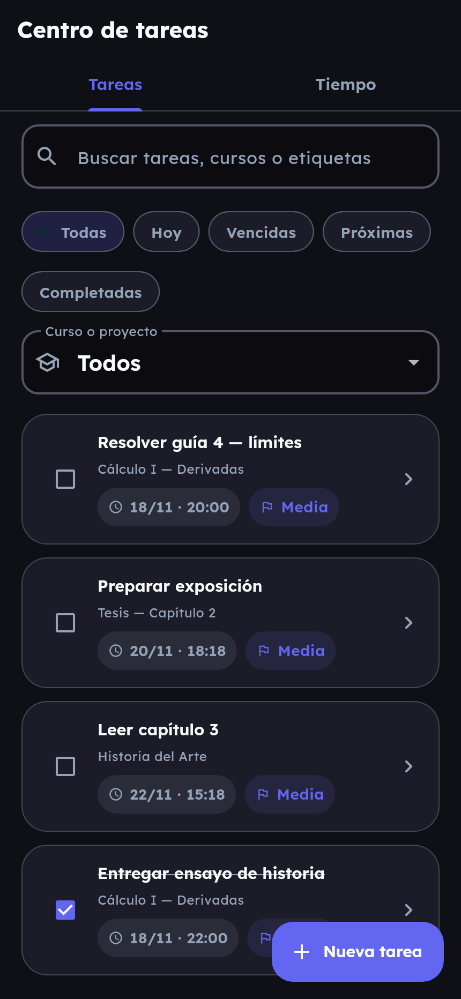 | 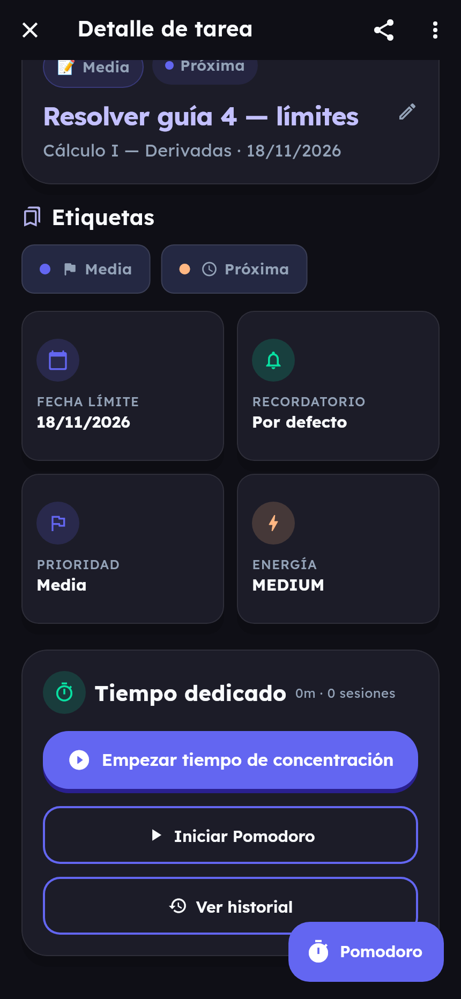 |
| **Búsqueda y filtros** (Hoy, Vencidas, Próximas, Completadas), selector de curso, acciones rápidas y pestaña de tiempo con historial de foco. | **Edición completa**: prioridad, energía, recordatorio, etiquetas, adjuntos, subtareas reordenables, tiempo dedicado y accesos directos a Pomodoro. |

<p align="center">
  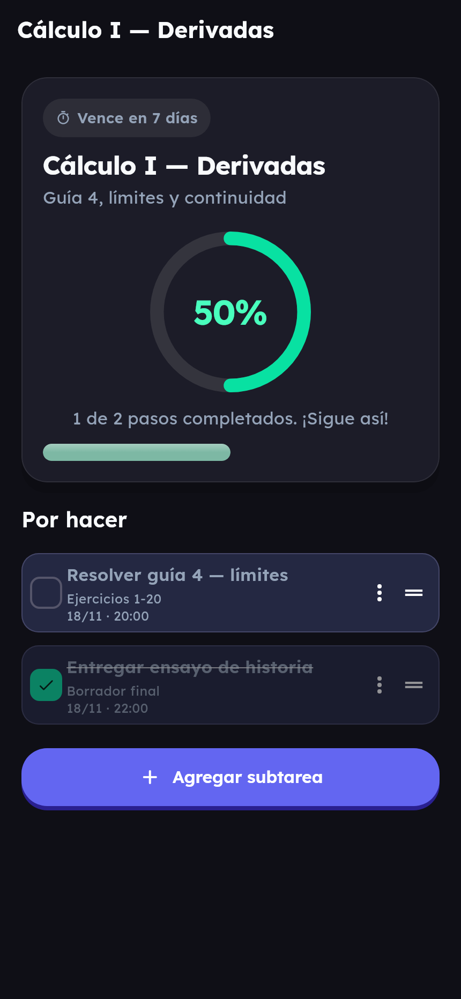
  <br />
  <em>Detalle de proyecto: progreso por pasos, checklist reordenable y generación automática de un plan convertible en bloques de estudio.</em>
</p>

### 🎙️ Captura por voz

| Nueva tarea por voz | Nuevo horario por voz |
|:---:|:---:|
| 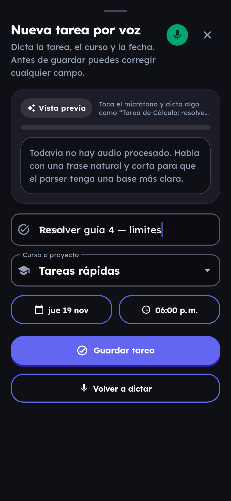 | 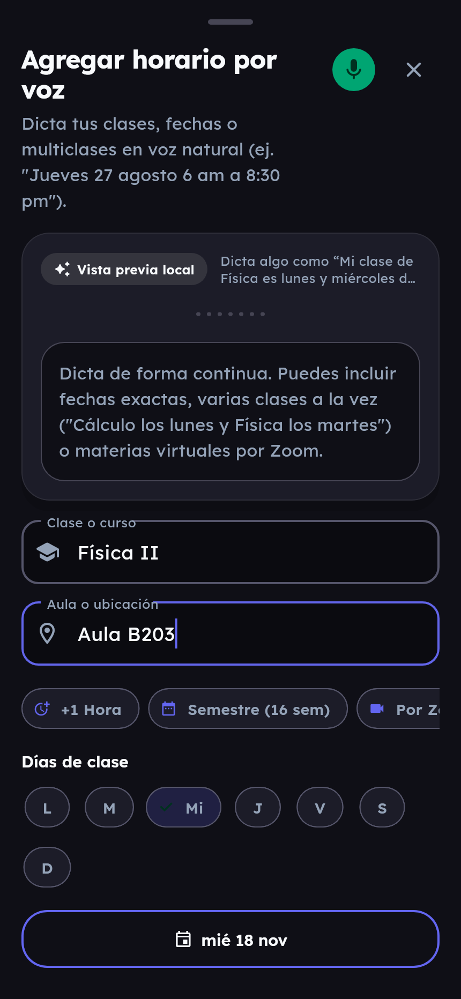 |
| **Dicta una frase natural** y UniThrive extrae título, curso, fecha y hora. Todo queda en campos editables antes de guardar. | **Dicta una o varias clases** con días, recurrencia, aula o Zoom. El parser local detecta fechas y repeticiones. |

### 🎯 Enfoque y progreso

| Temporizador Pomodoro | Preparación de sesión |
|:---:|:---:|
| 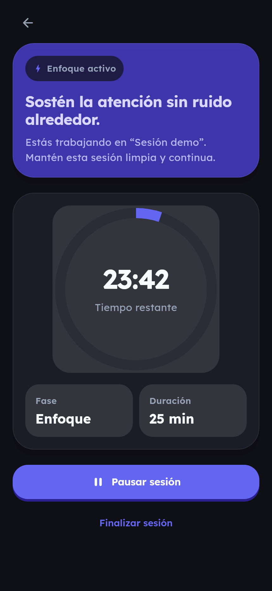 | 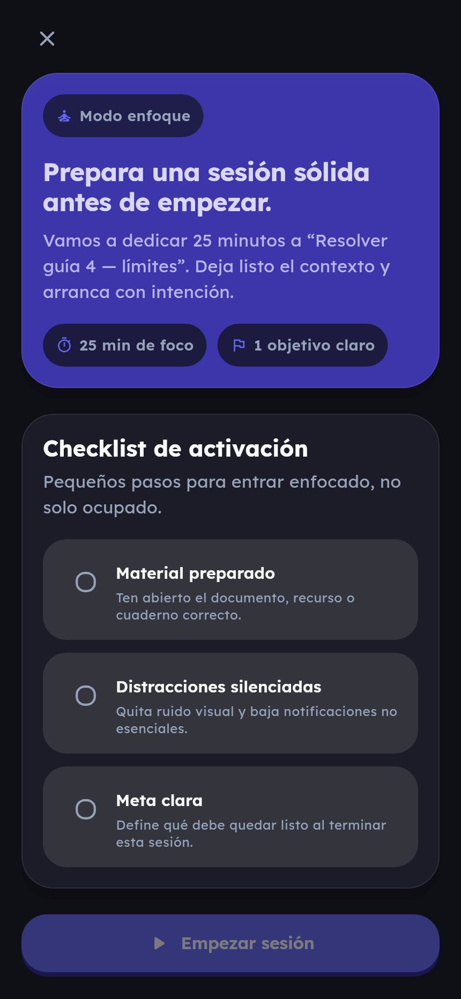 |
| **Cuenta atrás circular** con fase de enfoque/descanso, pausa, finalización y registro automático de la sesión. | **Checklist de activación** para preparar material, silenciar distracciones y definir una meta antes de empezar. |

| Estadísticas | Logros |
|:---:|:---:|
| 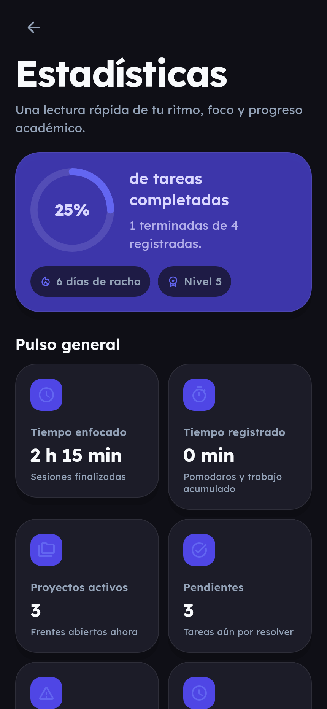 | 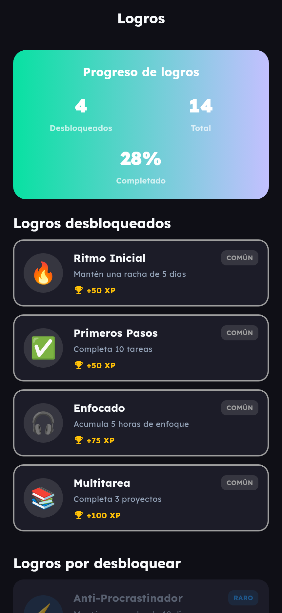 |
| **Pulso académico**: tareas completadas, tiempo enfocado, proyectos activos, pendientes y desglose por curso. | **Logros por rareza** (común, raro, épico, legendario), progreso, XP y recompensas desbloqueables. |

### 🔔 Recordatorios y alarmas

| Alarmas | Centro de recordatorios |
|:---:|:---:|
| 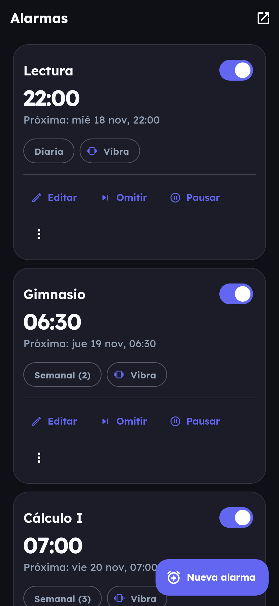 | 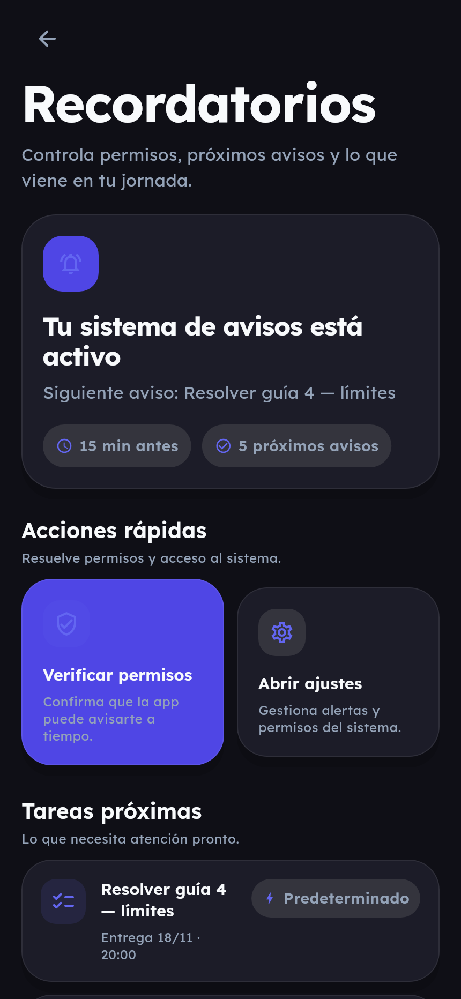 |
| **Alarmas recurrentes** con días de la semana, vibración, omitir, pausar y apertura del reloj del sistema. | **Estado de avisos**, próximo recordatorio, permisos y accesos rápidos para mantener las notificaciones al día. |

### 👤 Perfil, ajustes y navegación

| Perfil | Ajustes |
|:---:|:---:|
| 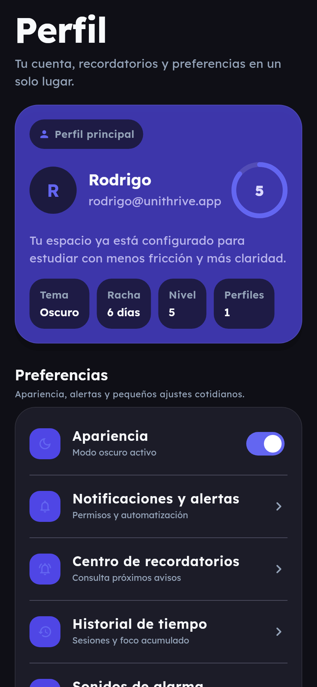 | 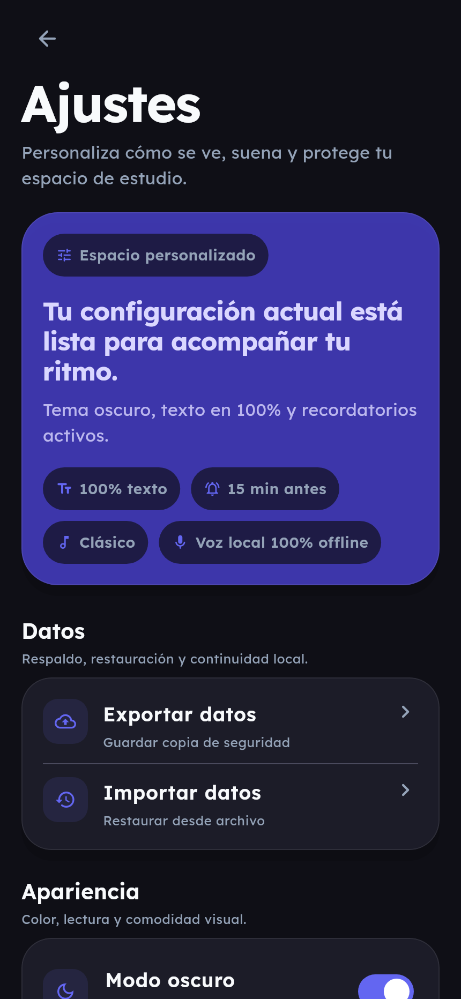 |
| **Identidad y preferencias**: avatar, nivel, racha, tema, multiperfil, notificaciones, historial y cierre de sesión local. | **Personalización**: tema, escala de texto, recordatorios, sonido de alarma, voz offline, respaldo y restauración. |

| Bienvenida | Navegación principal |
|:---:|:---:|
| 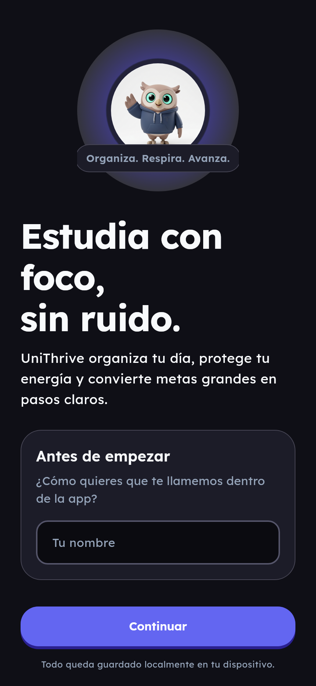 | 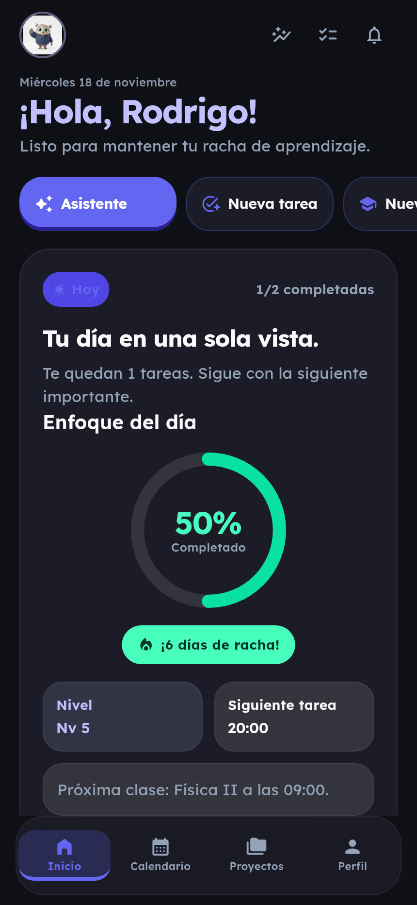 |
| **Onboarding breve** con mascota, nombre del estudiante y garantía de almacenamiento local. | **Shell con 4 tabs** (Inicio, Calendario, Proyectos, Perfil) y barra flotante con blur y safe-area. |

---

## 🧱 Bajo el capó

- **Flutter + Material 3** con un sistema de diseño propio: tema oscuro “Vivid Academic”, acentos menta/lila, tipografía **Lexend** empaquetada (sin descargar fuentes) y componentes `Uni*` reutilizables.
- **Estado hand-rolled**: `AppState` compone `settings`, `user`, `gamification`, `data` y `alarms`, reenvía sus notificaciones y expone una fachada. Se inyecta con `AppStateProvider` (`InheritedWidget`).
- **Persistencia local**: un blob JSON en `SharedPreferences` (`unithrive_state_v2`) con escrituras serializadas. Exportación/importación total y snapshots por perfil.
- **Servicios puros y testeables**: parser de voz/horario, planificador, mascota, coach de soporte, alarmas nativas, notificaciones y sincronización `.ics`.
- **Degradación por plataforma**: voz, alarmas nativas y notificaciones se habilitan en móvil; en web/Linux se muestra un aviso en lugar de invocar plugins no soportados.
- **Privacidad por diseño**: adjuntos en directorio privado, logs locales rotados y cero llamadas a un backend.

## 🚀 Instalación y desarrollo

### Requisitos

- Flutter 3.35+ (probado con **Flutter 3.44.9 / Dart 3.12.2**)
- Android Studio o VS Code con el SDK de Flutter
- Para voz y alarmas nativas: dispositivo/emulador Android

### Configuración local

```bash
git clone https://github.com/bel001/UniThrive-App.git
cd UniThrive-App
flutter pub get
flutter run
```

### Calidad

```bash
flutter analyze    # análisis estático limpio
flutter test       # suite de tests en español
```

### Regenerar las capturas de este README

Las imágenes viven en `capturas/` y se generan desde widgets reales con datos de demostración:

```bash
flutter test test/generate_capturas_test.dart
```

El generador carga las fuentes reales (Lexend, Material Icons y emoji), usa un viewport de 430 × 932 en tema oscuro y guarda PNG de 860 × 1864.

## 📱 Generar APK

```bash
flutter build apk --debug
```

El archivo queda en:

```text
build/app/outputs/flutter-apk/app-debug.apk
```

## 📁 Estructura rápida

```text
lib/
├── core/          # tema, tokens y constantes
├── models/        # tareas, proyectos, horario, logros...
├── services/      # voz local, alarmas, notificaciones, .ics, planner
├── state/         # AppState + sub-estados y persistencia
├── screens/       # features: home, calendar, projects, tasks, focus...
├── widgets/       # Uni* reutilizables y hojas de voz
└── main.dart      # arranque no bloqueante y themeMode

test/              # parser, planner, responsive, IA local, capturas
docs/              # diseño de sistema
```

---

Desarrollado con ❤️ para que estudiar sea un poco más claro.
